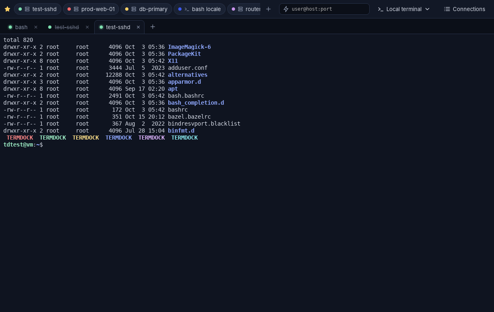

# Termdock

**English** · [Italiano](README.it.md)

Cross-platform terminal and connection manager (Windows, macOS, Linux), in the spirit of PuTTY / Windows Terminal, with a **favorites bar** to open the connections you use most with one click.



## Features

- **Favorites bar**, always visible: one click opens the connection in a new tab, drag to reorder, right click to edit or unpin, `Ctrl+Shift+1…9` opens the first nine.
- **SSH** with a full terminal (xterm-256color, truecolor, Unicode, resizing).
- **Jump hosts (ProxyJump)**: a connection can go through a bastion, even a chain of them; every hop verifies its own host key and authenticates separately.
- **File browser (SFTP)**: `Ctrl+Shift+S` opens the files of the server next to its terminal, on the same authenticated connection (no second login): browse, download, upload, new folder, rename, delete. After `sudo -iu user` in the terminal it offers to open the files as that user too (through sudo on the server, with the sudo password asked only when needed and never saved), or pick any user from its user menu. Files can be dragged from the computer onto the browser to upload them; the browser can jump to (or follow) the terminal's current folder; and *Edit* (`F4`) opens a remote text file in the system text editor (or the one chosen in Settings) and uploads it back each time it is saved, asking first if the server's copy changed meanwhile.
- **Port forwarding** saved in the connection: local (`-L`), remote (`-R`) and dynamic SOCKS5 (`-D`); the status of each tunnel is shown in the terminal.
- **Import from `~/.ssh/config`**: preview with warnings, then imports Host, HostName, User, Port, IdentityFile, ProxyJump and the forwards.
- **Local shells** in a real PTY: PowerShell 7, Windows PowerShell, cmd, WSL and Git Bash on Windows (ConPTY); bash, zsh, fish, pwsh… on macOS and Linux.
- **Connection manager**: groups, colors, search, star to pin to the favorites bar.
- **Quick connect**: type `user@host:port` in the bar and press Enter.
- Multiple tabs, reconnect with Enter after a session ends, PuTTY-style copy/paste (select + right click).
- **Split panes**, like Windows Terminal: divide a tab side by side or top/bottom as many times as needed and choose what opens in the new pane (the same connection, a local shell, any saved connection or a `user@host` address), e.g. server A on the left and server B on the right. Already open tabs can be put side by side without reconnecting (tab menu → *Move next to*), and favourites open directly on the right or below. Drag the dividers to resize, move between panes with `Alt+arrows`.
- **Saved layouts**: save a tab's arrangement (which connection or shell is in each pane, and the sizes) with `Ctrl+Shift+L` and reopen it from the *Layouts* menu with one click; one layout can open automatically at startup (its connections then start right away, with the usual host-key and password prompts).
- **Find in terminal**: `Ctrl+Shift+F` searches the scrollback with highlighted matches, next/previous (`Enter` / `Shift+Enter`), match case and regular expressions.
- **Themes and fonts**: dark, light or system theme; terminal colour schemes (Termdock Dark/Light, Solarized, Dracula, Nord, Gruvbox); font, size, line height, cursor style and scrollback, with a live preview in Settings; `Ctrl` + `+` / `-` / `0` changes the font size.
- **Automatic updates**: a new version is announced at start (and once a day), installed only after you confirm, and verified against the signing key built into the app; it can be turned off in Settings.
- **Multilingual interface** (English, Italiano): choose it in Settings (`Ctrl+,`) or leave *Automatic* to follow the system language; the switch is immediate and open sessions keep running.

### Shortcuts

| Keys | Action |
| --- | --- |
| `Ctrl+Shift+T` | new local shell (default one) |
| `Ctrl+Shift+E` / `Ctrl+Shift+O` | split the pane right / down (then choose what to open; Enter = same connection) |
| `Ctrl+Shift+S` | file browser (SFTP) for the SSH terminal |
| `Ctrl+Shift+F` | find in the terminal |
| `Ctrl+Shift+L` | save the tab as a layout |
| `Alt+←↑→↓` | move to the next pane (with several panes) |
| `Ctrl+Shift+W` | close the pane (the tab with its last pane) |
| `Ctrl+Tab` / `Ctrl+Shift+Tab` | next / previous tab |
| `Alt+1…9` | go to tab N |
| `Ctrl+Shift+1…9` | open favorite N |
| `Ctrl+Shift+K` | quick connect |
| `Ctrl+Shift+M` | connection manager |
| `Ctrl+Shift+C` / `Ctrl+Shift+V` | copy / paste |
| `Ctrl` + `+` / `-` / `0` | larger / smaller / default font size |
| `Ctrl+,` | settings (language, appearance, keys, files, updates) |
| right click in the terminal | copy the selection, otherwise paste |

These are the defaults (`Cmd` works in place of `Ctrl` on macOS). Every shortcut can be changed or turned off in **Settings → Keys**: click it and press the new keys; a combination already in use is moved only after confirmation, and keys that terminal programs or AltGr typing need get a warning first.

## Security

The main choices (details in [SECURITY.md](SECURITY.md)):

- **Rust backend** (memory safe), SSH implemented in pure Rust with [russh](https://github.com/Eugeny/russh): no external `ssh` process, no intermediate shell.
- **Modern algorithms only**: hybrid post-quantum key exchange `mlkem768x25519-sha256` first, then `curve25519-sha256`; AEAD ciphers (`chacha20-poly1305`, `aes-gcm`); encrypt-then-MAC SHA-2 MACs; *strict KEX* (Terrapin mitigation). SHA-1, CBC, DSA, `ssh-rsa` and compression are excluded.
- **Host key verification** before any authentication: on first connection the SHA-256 fingerprint is shown for confirmation (default: *Cancel*); if the key changes the connection is **refused** and the dialog offers no way to force it. Supports the OpenSSH format, including hashed entries, wildcards and `@revoked`, and also reads `~/.ssh/known_hosts`.
- **No secrets on disk**: passwords and passphrases are stored only if you ask, and only in the operating system keychain (Windows Credential Manager, macOS Keychain, Secret Service on Linux). They are wiped from memory after use (`zeroize`), never sent back to the UI, and deleted if the server rejects them.
- Changing a connection's host, port, user or authentication method deletes its saved password, so it is never sent to a different server.
- Authentication: SSH agent (ssh-agent, Windows OpenSSH agent, Pageant), private keys (also encrypted), password, keyboard-interactive / 2FA.
- Text coming from the server outside the session (banner, exit messages) is shown without control characters: no escape sequence injection.
- **Least-privilege Tauri 2**: strict Content-Security-Policy (no inline or remote scripts), every IPC command explicitly allowed in [`capabilities/default.json`](src-tauri/capabilities/default.json), no file system or shell plugins. The UI builds the DOM with `textContent` only (no `innerHTML`).
- Configuration files with `0600` permissions (`0700` folder) on Unix, atomic writes.
- **Signed updates**: every update package is verified (Ed25519/minisign) against the public key built into the app and must be signed for the version it claims to be, so neither a tampered package nor an older release can be installed. Details in [SECURITY.md](SECURITY.md#updates-src-taurisrcupdatesrs-scriptsupdater-manifestmjs).
- CI with `cargo audit`, `npm audit`, clippy with `-D warnings`, end-to-end tests against OpenSSH and weekly Dependabot.

> Tip: use **Ed25519** keys (`ssh-keygen -t ed25519`) protected by a passphrase, ideally loaded in an SSH agent.

## Architecture

```
crates/termdock-core   UI-independent logic, tested in isolation
  ├─ profile.rs         connection model, validation, "user@host:port" parser, jump chains
  ├─ store.rs           profiles.json (atomic, 0600) and favorites order
  ├─ vault.rs           OS keychain (keyring)
  ├─ hostkeys.rs        known_hosts: TOFU, changed/revoked keys
  ├─ ssh.rs             SSH client (russh): algorithms, authentication, jump hosts
  ├─ forward.rs         port forwarding -L / -R / -D (SOCKS5)
  ├─ sftp.rs            SFTP on the terminal's connection (file browser)
  ├─ sshconfig.rs       ~/.ssh/config import
  ├─ local.rs           local shells through a PTY (portable-pty / ConPTY)
  └─ shells.rs          detection of the available shells
src-tauri/             Tauri 2 desktop app: IPC commands, prompts, state
src/                   TypeScript + xterm.js UI (no framework)
```

Terminal data travels on binary Tauri IPC channels; questions for the user (host key, password, OTP) use a separate channel and expire after 3 minutes.

Data is stored in:

| System | Path |
| --- | --- |
| Windows | `%APPDATA%\dev.termdock.app\` |
| macOS | `~/Library/Application Support/dev.termdock.app/` |
| Linux | `~/.config/dev.termdock.app/` |

(`profiles.json` and `known_hosts`; passwords live only in the keychain. Interface preferences such as language and appearance, and saved layouts, are kept in the web view's local storage.)

## Development

Requirements: stable [Rust](https://rustup.rs) (≥ 1.90), Node.js ≥ 22 and the [Tauri prerequisites](https://tauri.app/start/prerequisites/) for your system (on Linux: `libwebkit2gtk-4.1-dev`, `libgtk-3-dev`, `librsvg2-dev`, `libdbus-1-dev`).

```sh
npm ci
npm run tauri dev        # run the app in development mode
npm run tauri build      # build the installers (MSI/NSIS, DMG, AppImage/deb/rpm)
```

Tests and checks:

```sh
cargo test --workspace
cargo clippy --workspace --all-targets -- -D warnings
npm run typecheck
npm run version:check

# end-to-end tests against a real OpenSSH (Linux, needs root and openssh-server;
# creates throw-away users and sudo rules, so use a VM or CI runner)
eval "$(sudo scripts/e2e-sshd.sh)"
cargo test -p termdock-core --test ssh_e2e
```

The end-to-end tests cover: unknown host key refused, trust on first use, wrong password and retries, password remembered in the keychain and forgotten when rejected, encrypted private key with passphrase, keyboard-interactive, jump host with `-L` / `-R` / `-D` forwards, SFTP (upload, overwrite, download, cancel, rename, delete, rejected names), SFTP as another user through sudo (without password, password only after the prompt, wrong then right, three tries, refused user, unsafe names), session close and **changed host key (MITM simulation)**.

Claude Code cloud sessions are prepared by `.claude/hooks/session-start.sh`, and the project skills in `.claude/skills/` describe the PR/release procedure and how to run the app headless.

Code, comments and commit messages are in English; documentation is kept in English and Italian (`*.md` and `*.it.md`).

UI strings live in [`src/locales/`](src/locales), one file per language. To add a language, copy `en.ts` to `<code>.ts`, translate it (the `Dict` type makes the build fail if a key is missing) and register it in `LANGUAGES` in [`src/i18n.ts`](src/i18n.ts); it then appears in Settings.

Versions and releases are automated: every PR updates [CHANGELOG.md](CHANGELOG.md) and [CHANGELOG.it.md](CHANGELOG.it.md); a release is prepared with `npm run version:set -- X.Y.Z`, which updates the version in every file (`npm run version:check` verifies it in CI). When the PR lands on `main`, the [`release.yml`](.github/workflows/release.yml) workflow creates the `vX.Y.Z` tag and builds the installers for every platform into a draft release, with the changelog section as notes. Distributing on macOS/Windows without system warnings requires signing certificates (see the comments in the workflow).

In-app updates need the updater signing key, created once by the owner:

```sh
npm run tauri signer generate -- -w ~/.tauri/termdock.key
```

Without Node.js, [minisign](https://jedisct1.github.io/minisign/) produces compatible keys: run `minisign -G -p termdock.pub -s termdock.key` (it asks for the password), then use the **Base64 encoding** of each file where the steps below mention its content (PowerShell: `[Convert]::ToBase64String([IO.File]::ReadAllBytes("termdock.key"))`; macOS/Linux: `base64 < termdock.key | tr -d '\n'`).

The public key (`~/.tauri/termdock.key.pub`) goes into `plugins.updater.pubkey` in `src-tauri/tauri.conf.json`. The private key goes into an offline backup (without it, installed copies can no longer be updated) and into GitHub: *Settings → Environments → New environment* `release`, *Deployment branches and tags* limited to the branch `main` and the tag pattern `v*`, then the environment secrets `TAURI_SIGNING_PRIVATE_KEY` (content of `~/.tauri/termdock.key`) and `TAURI_SIGNING_PRIVATE_KEY_PASSWORD`. Do not store them as repository secrets: those can be read by workflows on any branch.

The release workflow checks the key before tagging, signs every package, verifies them with `scripts/updater-manifest.mjs` and attaches `latest.json`, which installed apps read once the release is published. **Publish a draft only if it has `latest.json`**: without it, installed copies stop finding updates. deb/rpm installs are only notified (the package manager updates them).

## License

[MIT](LICENSE)
